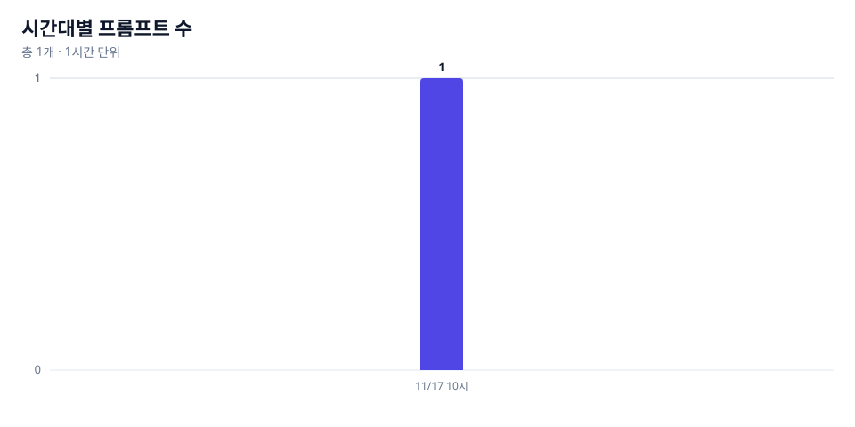

# 개발 과정 분석 요약 (자동 생성)

| 항목 | 값 |
|---|---|
| 총 프롬프트 수 | 1개 |
| 기간 | 2026-11-17 10:29 ~ 2026-11-17 10:29 (약 0시간 0분) |
| 평균 프롬프트 길이 | 5142자 |

## 유형별
| 유형 | 개수 | 비율 |
|---|---|---|
| 오류 수정 | 1 | 100% |

## 시간대별
| 시간 | 개수 |
|---|---|
| 11/17 10시 | 1 |

## 가장 자세했던 프롬프트 (보고서 사례 후보)
- #1 (5142자): Background (from the session that started this one): This folder (`E:\Claude_Work\Vibethon\sns-ma\advertiser`) is 애드체크 비…

