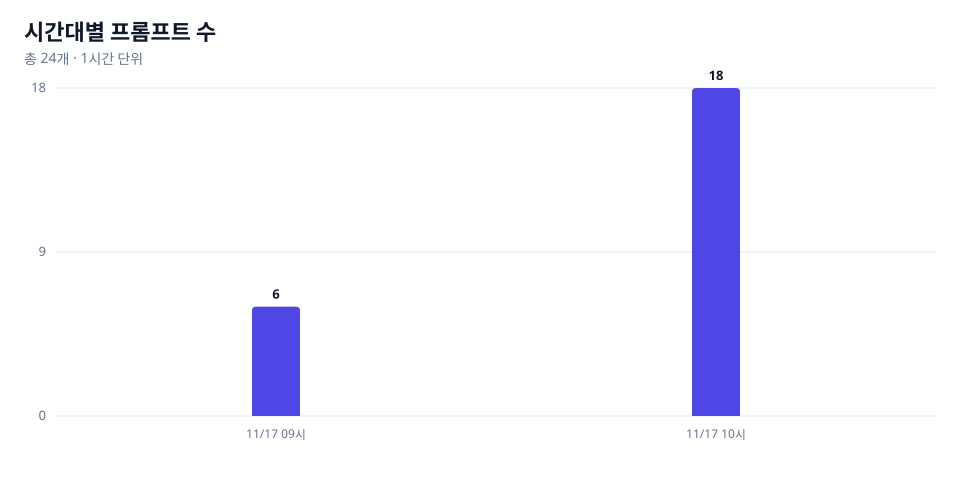
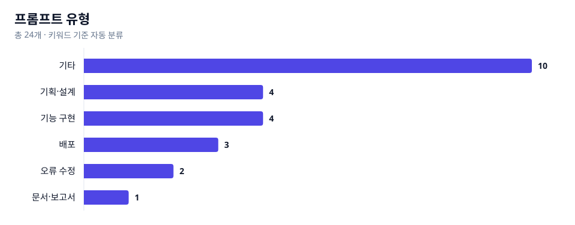
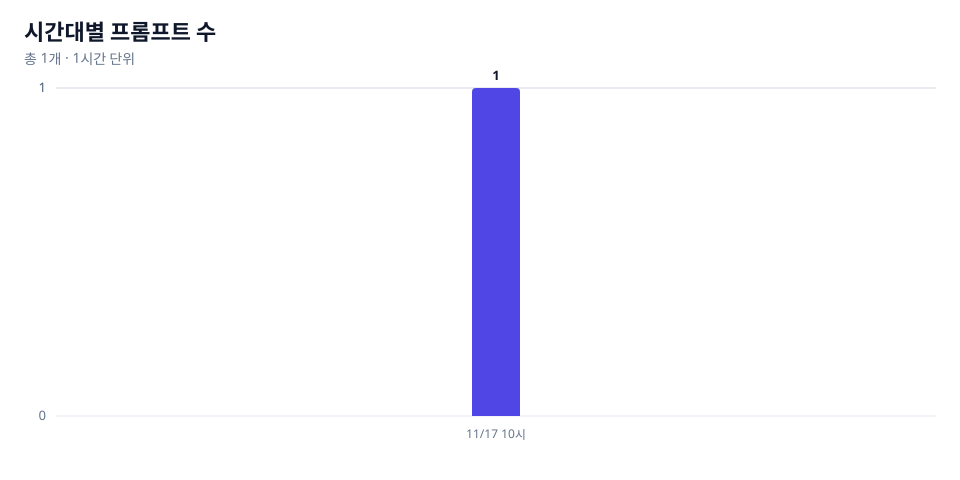
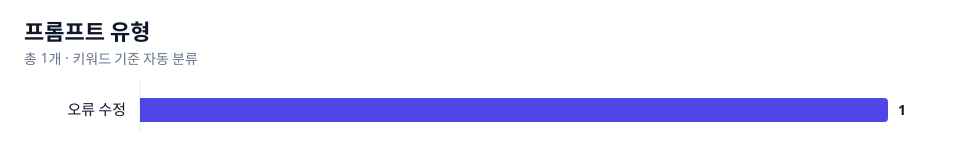

# 2026 바이브톤 결과 보고서

- 참가자: (이름)
- 학과: SNS마케팅 전공
- 작품명: **애드체크 (AdCheck)** — 뒷광고 예방 체크기 / 짝 앱 **애드체크 비즈 (AdCheck Biz)** — 광고주용 뒷광고 검수 도구
- 배포 주소:
  - 애드체크 (크리에이터용): https://adcheck-vibethon.vercel.app
  - 애드체크 비즈 (광고주용): https://adcheck-biz-vibethon.vercel.app (https라서 카메라 촬영 가능)
  - 소스 코드 (GitHub): https://github.com/lee-changyeon/adcheck-vibethon
- 개발 기간: 2026-11-17 09:37 ~ 16:30 (본 대회, 개인 참가)

---

## 1. 개요
- **대회 주제:** 전공을 연계한 문제해결 (전공: SNS마케팅)
- **한 줄 소개:** 협찬을 처음 받는 인플루언서가 몰라서 하게 되는 **뒷광고**를, 공정거래위원회 「추천·보증 등에 관한 표시·광고 심사지침」 기준으로 **올리기 전에(애드체크)** 그리고 **올라온 뒤에(애드체크 비즈)** 양쪽에서 막는 두 개의 웹앱
- **전공 연계:** SNS 마케팅 현장에서 가장 흔한 법적 위험인 "광고 표시"를, 인플루언서와 광고주라는 마케팅의 두 주체 모두가 쓸 수 있는 도구로 풀었다.

## 2. 문제 정의
### 2-1. 누가, 무엇 때문에 불편한가
- **크리에이터:** 팔로워 1천~1만 명, 카페·식당·화장품 협찬을 막 받기 시작한 대학생 인스타그래머·블로거. 업체는 "자연스럽게 올려 주세요"라고만 하고, 본인은 "#협찬"을 해시태그 맨 끝에 붙이면 된다고 생각한다.
- **광고주:** 체험단 10~30명을 모집하는 동네 가게 사장님·브랜드 마케터. 게시물 수십 개를 하나씩 열어 표시 위치를 눈으로 확인해야 하고, 뒷광고가 적발되면 **광고를 맡긴 사업자도 제재 대상**이 될 수 있다.
- 심사지침은 길고 법률 용어라 읽히지 않으며, **어떤 말로, 어디에**(첫 부분, 한글, 해시태그에 묻히지 않게) 표시해야 하는지가 잘 알려져 있지 않다.

### 2-2. 문제의 근거 (2026-11-17 조사)
| 근거 | 내용 | 출처 |
|---|---|---|
| 적발 규모 | 공정위가 2021~2025년 모니터링한 SNS 뒷광고 의심 게시물 **약 10만 9천 건** (2025년 2만 2,675건) | 서울경제TV, SBS 뉴스 |
| 적발 유형 | 2024년 점검: **부적절한 위치 39.4%**, 표시 안 함 26.5%, 부적절한 표현 17.3% | 공정위 국민생각함, 서울경제 |
| 표시 실태 | 국내 상위 인플루언서 광고 게시글 582건 중 대가를 밝힌 글 **29.9%** | 한국소비자원 조사 (어패럴뉴스 보도) |
| 기준 강화 | 2024-09-01 시행 개정 심사지침: 본문 중간·댓글·'더보기' 안의 표시는 인정 안 됨, 국내 대상이면 AD·PR·Sponsor 등 외국어 표현도 부적절 | 어패럴뉴스, 김앤장 |

- 적발 유형 상위 3개(**위치·미표시·표현**, 합계 83.2%)가 애드체크의 핵심 점검 규칙(표시 위치·표시 없음·애매한 표현)과 그대로 일치한다.
- 공정위 점검은 **이미 올라간 글을 적발한 뒤 시정을 요청**하는 사후 방식이다 → **올리기 전 예방** 도구가 필요하다.

### 2-3. 유사 서비스 비교 (2026-11-17 웹 검색)
| 구분 | 서비스 | 하는 일 | 애드체크와 다른 점 |
|---|---|---|---|
| 국내 정부 | 공정위·한국인터넷광고재단 모니터링 | SNS 후기 게시물 점검 → 자진 시정 요청 | 이미 올라간 글 대상, 일반인용 점검 도구 없음 |
| 국내 민간 | 인플루언서 마케팅 플랫폼 (예: 스타트뷰) | 인플루언서 탐색·협업 관리 | 광고 표시 검수 기능 확인 안 됨 |
| 국내 민간 | 법률·마케팅 블로그 안내글 | "협찬 문구 쓰는 법" 설명 | 읽는 자료일 뿐, 내 글을 점검하지 않음 |
| 해외 | PostEverywhere FTC Disclosure Checker | 캡션 붙여넣기 → 표시 여부·위치·명확성 점수 | **가장 유사.** 미국 FTC 기준이라 "#ad"를 정답으로 봄 → 한국 기준과 다름, 고친 글 생성 없음 |
| 해외 | TapInfluence FTC Auditor, Octoly, Modash | 광고주용 게시물 자동 검사·모니터링 | 유료 광고주 플랫폼, 이미 올라간 글 추적 중심 |

**차별점:** ① 한국 공정위 기준(해외 도구가 정답으로 보는 "#ad"·"Sponsored"를 문제로 잡음) ② 올리기 전 예방 ③ 고친 글 자동 생성 ④ 개인 크리에이터용·무료·로그인 없음 ⑤ 자주 틀리는 항목 통계로 습관 교정 ⑥ 광고주용 짝 앱까지 같은 기준으로 제공
> 검색으로 찾지 못했다고 존재하지 않는다고 단정할 수는 없어, "국내 기준의 사전 점검 도구는 찾지 못했다"로 표현한다.

## 3. 해결 방안 — 두 앱이 양쪽에서 막는다
| 구분 | 애드체크 (크리에이터용) | 애드체크 비즈 (광고주용) |
|---|---|---|
| 언제 | **올리기 전** | **올라온 뒤** |
| 사용자 | 글을 쓰는 인플루언서 | 협찬을 맡긴 광고주 |
| 단위 | 내 글 1개 | 캠페인 1개 = 게시물 여러 개 |
| 결과 | 점수 + **고친 글** | 인플루언서별 판정 + **수정 요청 메시지** |
| 조치 | 내가 고쳐서 올림 | 미조치 → 요청함 → 확인 완료 **상태 관리** |
| 점검 규칙 | 원본 `src/data/rules.ts` | 같은 규칙 복사본 (`npm run sync-rules`) |
| 대표 색 | 남색 | 청록 (한눈에 구분) |

## 4. 주요 기능과 화면
### 4-1. 애드체크 (크리에이터용, v0.2)
| 기능 | 설명 | 화면 |
|---|---|---|
| ① 광고 표시 점검 | 플랫폼(인스타그램·블로그·유튜브)·받은 대가·업체명·글 입력 → 점수, 판정(적합/보완 필요/위반 위험), 문제 항목별 "무엇이, 왜" 설명 | 점검 탭 |
| ② 고친 글 제안 | 애매한 표현·반대 표현·해시태그 표시를 지우고 첫 줄에 `[협찬] (업체)로부터 제품을 무상으로 제공받아 작성한 글입니다.`를 붙인 수정본 → 복사, **고친 글로 다시 점검** | 점검 탭 |
| ③ 이력·통계 | 점검할 때마다 자동 저장(최근 100개), 점검 수·평균 점수·통과율, **자주 틀리는 항목 차트**(최다 항목 강조) + 다음 글에서 지킬 한 가지 | 이력·통계 탭 |
| ④ 표시 규칙 가이드 | 뒷광고 설명, 꼭 지킬 4가지(좋은 예·나쁜 예), 샘플 데이터 초기화 | 가이드 탭 |

### 4-2. 애드체크 비즈 (광고주용, v0.3)
| 기능 | 설명 | 화면 |
|---|---|---|
| ① 캠페인 등록 | 캠페인 이름·브랜드·제공한 대가를 한 번만 입력 | 캠페인 탭 |
| ② 게시물 일괄 검수 | 인플루언서 계정·플랫폼·글 붙여넣기 → 즉시 판정, 필터(전체/조치 필요/문제 없음) | 게시물 탭 |
| ③ 수정 요청 메시지·조치 상태 | 인사·문제 항목·**수정 예시 글**·심사지침 안내가 든 메시지 생성 → 복사하면 "수정 요청함", 고친 글을 재검수해 적합이면 "확인 완료" | 게시물 상세 |
| ④ 대시보드 | 게시물 수·**준수율**·조치 필요 수, 판정 분포 차트, 조치 필요 목록 | 대시보드 탭 |
| ⑤ **화면 스캔** | 글을 복사할 수 없을 때(인플루언서가 휴대폰으로 보여 줄 때, 회의실 모니터) **연속 8장 촬영** → 선명도·줄무늬 점수로 가장 좋은 장면 추천(또는 합성본) → 한글 OCR → 게시물 등록·검수 | 화면 스캔 탭 |

> 화면 캡처는 `docs/images/`에 넣어 위 표의 "화면" 칸에 연결한다.

## 5. 기술 구성
```
[휴대폰 브라우저]
  ├─ 애드체크 (React 앱) ──────┐
  │                             ├─ 규칙 엔진 rules.ts (같은 6개 규칙, 브라우저 안에서 즉시 계산)
  ├─ 애드체크 비즈 (React 앱) ─┘        └─ localStorage (이력·캠페인·게시물 저장)
  │        └─ 화면 스캔: frames.ts(장면 점수·합성) → tesseract.js(브라우저 안 한글 OCR)
  └─ 외부 서버·API 키 없음 → 네트워크가 끊겨도 점검 시연 가능
```
| 영역 | 기술 | 선택 이유 |
|---|---|---|
| 화면 | Vite + React 19 + TypeScript | 타입 검사로 AI가 만든 코드의 오류를 빌드 단계에서 잡음 |
| 디자인 | Tailwind CSS v4 | 클래스만으로 빠르고 일관된 모바일 디자인 |
| 차트 | recharts | 자주 틀린 항목·판정 분포 시각화 |
| 데이터 | localStorage | 서버 없이 바로 동작, **글이 휴대폰 밖으로 나가지 않음** |
| OCR | tesseract.js 7.0.0 (광고주용만) | 브라우저 안에서 한글 인식, 서버·API 키 불필요 |
| 배포 | Vercel | 링크 하나로 휴대폰에서 바로 시연 |

### 5-1. 규칙 엔진 설계
점검 규칙은 화면과 분리된 **순수 함수** `runCheck({ platform, reward, brand, text })` 하나로 만들었다. 같은 입력이면 항상 같은 결과가 나오고, AI 호출이 없어 즉시·무료·오프라인으로 동작한다.

| 코드 | 판정 | 조건 | 감점 |
|---|---|---|---|
| NO_DISCLOSURE | 🔴 위반 | 대가를 받았는데 인정되는 한글 표시(광고·협찬·유료광고·제공받아 등)가 없음 | −35 |
| FALSE_CLAIM | 🔴 위반 | 대가를 받았는데 "내돈내산", "협찬 아님" 등 반대 표현 | −35 |
| LATE_POSITION | 🔴 위반 | 표시가 첫 부분(인스타 40자, 블로그·유튜브는 제목·첫 줄)에 없어 '더보기'를 눌러야 보임 | −35 |
| VAGUE_WORD | 🟡 보완 | thanks to, with, #ad, #sponsored, 체험단, gifted 등 애매·외국어 표현 | −15 |
| BURIED_HASHTAG | 🟡 보완 | 표시가 해시태그뿐이고 해시태그가 5개 이상이라 묻힘 | −15 |
| NOT_SPECIFIC | 💡 팁 | 무엇을 받았는지(제품 제공·원고료 등) 구체적으로 적지 않음 | −5 |

- 점수 = 100 − 감점 합계(최소 0). 위반이 하나라도 있으면 "위반 위험", 보완만 있으면 "보완 필요", 그 외 "적합". 대가 없음(내돈내산)이면 표시 의무가 없으므로 적합.
- **원본 하나, 복사본 하나:** 광고주용 앱은 규칙을 직접 고치지 않고 원본을 `npm run sync-rules`로 복사한다 → 두 앱의 판정이 절대 달라지지 않는다.
- 광고주용은 판정을 저장하지 않고 매번 계산한다 → 규칙이 바뀌면 지난 게시물도 새 기준으로 바로 다시 판정된다.

### 5-2. 화면 스캔 설계 (광고주용)
모니터·휴대폰 화면을 찍으면 **화면 깜빡임(주사율)과 셔터가 어긋나 가로 줄무늬·모아레**가 생기고 손떨림으로 흐려진다. 그래서 "여러 장 찍고 가장 좋은 장면을 고르는" 방식을 택했다.
1. 장마다 **선명도** = 라플라시안 분산
2. **줄무늬** = 모든 장의 중앙값 합성본과의 가로줄 밝기 차이 (글줄·사진은 지워지고 장마다 위치가 바뀌는 줄무늬만 남음)
3. 점수 = 선명도 ÷ (1 + (줄무늬/12)²) → 1위 '추천'
4. **합성본** = 선명한 상위 2/3를 위치 맞춘 뒤 픽셀별 중앙값
5. OCR 전처리(흑백·명암·2배 확대) → tesseract.js 'kor+eng' → 계정 줄·좋아요·시간 제거 → 검수

**측정 결과** (예시 6장 + 합성본, 원문 대비 글자 일치율): 추천 장면 **100%**(신뢰도 90%), 합성본 81%, 줄무늬 심한 장 33~97%, 많이 흐린 장 **0~1%** → "여러 장 찍고 고르기"가 필요하다는 근거.

## 6. AI 활용 과정 (바이브코딩)
- 사용 도구: Claude Code (데스크톱 앱)
- 사전 준비한 자동화: 모든 프롬프트 자동 기록(훅), 작업 종료 시 자동 오류 검사(타입·린트·빌드), 문서 6종 템플릿, 프롬프트 분석 차트 스크립트
- **세션 나누기:** 주제가 바뀔 때마다 별도 세션을 열었다 — 크리에이터 앱(메인), 광고주 앱 화면 스캔, 두 앱 배포, 보고서. 사용자가 중간에 "주제가 바뀌면 같은 세션에서 계속할지 새 세션을 열지 물어봐 줘"라고 규칙을 추가했고, 이 규칙은 두 앱의 CLAUDE.md와 AI 메모리에 기록됐다.

### 6-1. 개발 흐름과 시간 (두 앱의 `03_작업목록.md` 기준)
| 시각 | 단계 | 내용 |
|---|---|---|
| 09:37 ~ 09:44 | 주제 선정 | 전공 연계 주제 후보 5개 검토 → "뒷광고 체크기" 선정 |
| 09:47 | 환경 준비 | 리허설 프로젝트를 임시 `adcheck` 폴더로 복사, 오늘 프롬프트 기록 이관 |
| 09:49 | 문서 | 기획서·기술설계 |
| 09:55 | 구현 | 데이터 타입·규칙 엔진 6개 → 점검·고친 글·이력·통계·가이드 (예시 4개 모두 기대 판정) |
| 09:58 | 폴더 이관 | `sns-ma`로 이관, **리허설 폴더는 손대지 않음**, 임시 폴더 삭제 |
| 10:03 | 시연 시뮬레이션 | 375px에서 30점 → 고친 글 100점 확인 |
| 10:11 | 근거 조사 | 유사 서비스 조사, 기획서에 근거 통계·비교표 추가 |
| 10:14 ~ 10:22 | 광고주용 앱 | "애드체크를 쓰지 않는 인플루언서의 글은 광고주가 점검해야 한다" → 애드체크 비즈 기획·구현·검사 (준수율 38% → 50% 확인) |
| 10:24 ~ 10:40 | 화면 스캔 | 카메라 연속 촬영·장면 점수·합성·OCR (별도 세션) |
| 10:31 | 환경 분리 | 광고주 앱을 `advertiser/` 독립 환경으로 분리 (CLAUDE.md·훅·문서·프롬프트 기록) |
| 10:35 | 데이터 정책 | "배포하면 쌓이는 DB는 어떻게?" 질문 → 3단계 DB 로드맵 (향후계획) |
| 10:49 ~ | 배포 | 두 앱 배포 (별도 세션) |
| 10:52 ~ | 문서 | 보고서·향후계획 (별도 세션), 발표 자료 |

→ 주제 선정부터 크리에이터 앱 핵심 기능 완성까지 **약 18분**, 광고주 앱(화면 스캔 포함)까지 **약 1시간 3분**.

### 6-2. 프롬프트 기록 분석 (`npm run analyze`)
**크리에이터용 (`docs/analysis/`)**
| 항목 | 값 |
|---|---|
| 총 프롬프트 수 | 24개 (사용자가 직접 입력 20개 + 다른 세션 완료 알림 등 자동 메시지 4개) |
| 기간 | 09:37 ~ 10:53 (약 1시간 16분) |
| 평균 길이 | 454자 (자동 메시지 포함. 사용자 입력은 대부분 한두 문장) |
| 유형별 | 기타 42%, 기획·설계 17%, 기능 구현 17%, 배포 13%, 오류 수정 8%, 문서·보고서 4% |
| 시간대별 | 9시 6개, 10시 18개 |




**광고주용 (`advertiser/docs/analysis/`)**
| 항목 | 값 |
|---|---|
| 총 프롬프트 수 | 1개 (10:29, 5,142자) |
| 내용 | 메인 세션이 화면 스캔 세션에 넘긴 **작업 지시서** 한 건. 배경·문제·요구 사항·완료 기준을 담아 한 번에 기능 전체를 구현 |




- "기타"가 많은 이유: "이 앱을 누가 어떻게 활용할 수 있는지 설명해 줘", "시뮬레이션 해볼까?", "유사한 앱이 있나?"처럼 **질문·검토형 프롬프트**가 많았다. 코드를 바로 만들게 하기보다 **먼저 묻고 확인한 뒤 진행**한 흔적이다.
- 분석은 보고서 작성 시점까지의 기록이며, `npm run analyze`로 언제든 다시 만들 수 있다.

### 6-3. 핵심 프롬프트 사례
1. **"주제가 전공을 연계한 문제해결이야. 내 전공이 SNS마케팅 전공인데 어떤 주제가 적당한지 검토해 줘"** → AI가 후보 5개를 제안했고, 개념을 다시 물어 이해한 뒤 2번(뒷광고 체크기)을 골랐다.
2. **"이런 서비스를 제공하는 앱이 없나? 유사한 앱이라도 있는지 확인해 줘" → "기획서에 넣어 줘"** → 웹 검색으로 국내·해외 서비스를 비교하고, 근거 통계와 함께 기획서에 반영했다.
3. **"애드체크를 사용하지 않는 인플루언서들의 글을 광고주가 점검해야 하는 경우도 있다면 이를 점검하는 광고주용 앱도 필요하다"** → 같은 규칙 엔진을 쓰는 두 번째 앱으로 확장.
4. **"모니터 화면 혹은 스마트폰을 촬영할 때 프레임의 불일치로 이미지가 확인하기 어려운 상황을 개선하기 위해 다회 촬영 후 선명한 화면을 선택하여…"** → 문제를 구체적으로 설명하자 AI가 선명도·줄무늬 점수와 중앙값 합성으로 풀었다.
5. **"애드체크를 배포할 경우 크리에이터가 사용하면서 쌓이게 되는 DB는 어떻게 처리하지"** → 개인정보를 기준으로 3단계 데이터 로드맵을 세웠다.

## 7. 어려웠던 점과 해결
| 문제 | 원인 | 해결 |
|---|---|---|
| 복사한 프로젝트에서 타입 검사 실패 | 폴더 복사(robocopy `/XD dist`)가 node_modules 안의 dist까지 제외 | 리허설 교훈대로 복사 후 `npm ci` 재설치 |
| 미리보기 서버가 리허설 앱을 띄움 | 미리보기 설정이 리허설 폴더를 가리킴 | `launch.json`에 이 폴더 전용 설정 추가 (포트 5175, 광고주용 5176) |
| 리허설 배포본을 덮어쓸 위험 | 배포 프로젝트 이름이 같음 | 배포 명령의 프로젝트 이름을 새 앱 이름으로 변경 (광고주용 `adcheck-biz-vibethon`) |
| 두 앱의 판정이 달라질 위험 | 규칙 파일이 두 곳에 존재 | 원본 한 곳만 고치고 `npm run sync-rules`로 복사하는 규칙을 CLAUDE.md에 명시 |
| 한 폴더에 두 앱 작업이 섞임 | 광고주 앱 작업 기록이 크리에이터 앱 문서·프롬프트 기록에 쌓임 | `advertiser/`를 CLAUDE.md·훅·문서·프롬프트 기록을 가진 독립 환경으로 분리 |
| 화면 스캔: 글줄·사진까지 줄무늬로 잡힘 | 가로줄 평균 밝기를 그대로 사용 | 모든 장의 중앙값 합성본과의 **차이**로 측정 → 깜빡임 줄무늬만 남김 |
| 화면 스캔: 합성본이 흐림 (OCR 36%) | 손떨림으로 장마다 위치가 어긋남 | 합성 전 ±5픽셀 위치 맞추기 → **81%** |
| 카메라가 휴대폰에서 안 켜짐 | 카메라는 https·localhost에서만 동작 | 보안 연결일 때만 카메라 버튼 표시, 아니면 **사진 여러 장 불러오기·예시 화면**으로 대체 |
| 첫 OCR이 느림·오프라인 실패 | 한글 언어 데이터를 처음 한 번 인터넷에서 받음 | 처음 쓸 때만 불러오기(지연 로딩), 90초 제한, 실패 시 사진을 보며 직접 입력 |

- 오류 관리: 기능을 끝낼 때마다 `npm run check`(타입 검사 + 린트 + 빌드)를 실행했고, 작업 종료 시 훅이 자동으로도 검사했다. 외부 API를 쓰지 않아 시연 중 네트워크 오류로 멈출 일이 없다.

## 8. 시연 시나리오 (약 3분 30초)
**애드체크 (2분)**
1. 점검: **예시 글로 체험하기** → 해시태그 끝에 `#thanksto베이글하우스`만 붙은 협찬 글 → **위반 위험 30점** (표시 위치·해시태그에 묻힘·애매한 표현)
2. **고친 글 복사** → 첫 줄에 `[협찬] 베이글하우스로부터 제품을 무상으로 제공받아 작성한 글입니다.` → **고친 글로 점검** → **100점 적합**
3. 통계: "가장 많이 틀린 항목은 '표시 위치가 뒤쪽'" 차트 → 가이드에서 규칙 확인

**애드체크 비즈 (1분 30초)**
1. 대시보드: "베이글하우스 신메뉴 체험단" 게시물 8개 중 위반 위험 4개, 판정 분포 차트
2. 위반 게시물 → **수정 요청 메시지** 복사(상태 "수정 요청함") → 고친 글 재검수 → **적합, 확인 완료** → 준수율 상승
3. 화면 스캔: **예시 화면으로 체험** → 줄무늬·흐림이 섞인 6장 중 **추천** 장면 → 글자 인식 → 게시물로 등록 → `@daegu_brunch_log` **45점 위반 위험** (#협찬이 해시태그 맨 끝에 묻힘)

> 시연 전 체크: 화면 스캔은 처음 한 번 한글 데이터를 받으므로 시연 직전에 한 번 실행해 둔다.

## 9. 결과 및 성과
- 기획한 크리에이터용 기능 4개(필수 2 + 여유 2)를 모두 완성하고, 광고주용 짝 앱(기능 5개, 화면 스캔 포함)까지 만들었다.
- 공정위 적발 유형 상위 3개(83.2%)를 모두 점검하는 규칙 엔진을 두 앱이 공유한다.
- 예시 글 시연에서 30점 → 고친 글 100점, 광고주 앱에서 준수율 38% → 50%, 화면 스캔 추천 장면 OCR 100% 일치를 확인했다.
- 로딩·빈 화면·오류 상태와 카메라·OCR 실패 시 대체 경로를 모두 처리했다.
- 사용자 반응: (시연 중 받은 의견 기록)

## 10. 향후 계획 요약 (자세한 내용: `05_향후계획.md`)
- **데이터 로드맵 3단계:** ① 서버 없는 JSON 백업 → ② 글 원문 없이 익명 통계만(플랫폼·대가 종류·문제 코드·점수), 안내와 끄기 제공 → ③ 로그인·클라우드 저장(Supabase/Firebase), 개인정보 처리방침·동의·보관 기간 90일·원문 미저장 또는 암호화·탈퇴 시 삭제
- 지금의 **"글이 휴대폰 밖으로 나가지 않는"** 구조는 강점으로 유지하고, 로그인 없는 사용도 계속 남긴다.
- **두 앱 연결:** 크리에이터가 점검 결과를 링크·QR로 광고주에게 전달
- **화면 스캔 OCR 개선:** 기울기 보정, 글자 영역 자르기, 여러 장 결과 합치기
- **새 규칙:** AI 가상 인플루언서 표시, 숏폼 영상 안 표시(첫 몇 초 자막·음성)

## 11. 느낀 점
- 리허설에서 미리 만든 규칙(CLAUDE.md)·문서 템플릿·자동 검사 덕분에, 짧은 지시만으로 대회 시작 18분 만에 핵심 기능이 동작했다.
- 코드를 바로 만들게 하기보다 "누가 쓰나?", "비슷한 앱이 있나?", "DB는 어떻게 하나?"를 먼저 물으면서 **기획이 단단해졌고, 그 질문에서 광고주용 앱과 데이터 로드맵이 나왔다.**
- 주제별로 세션과 폴더를 나누니 작업 기록이 섞이지 않고, 여러 작업(화면 스캔·배포·보고서)을 동시에 진행할 수 있었다.
- SNS마케팅 전공에서 배운 "광고 표시 의무"가 실제로 얼마나 지켜지지 않는지(대가를 밝힌 글 29.9%) 확인했고, 이를 사람의 선의가 아니라 **도구로** 해결할 수 있다는 것을 배웠다.
