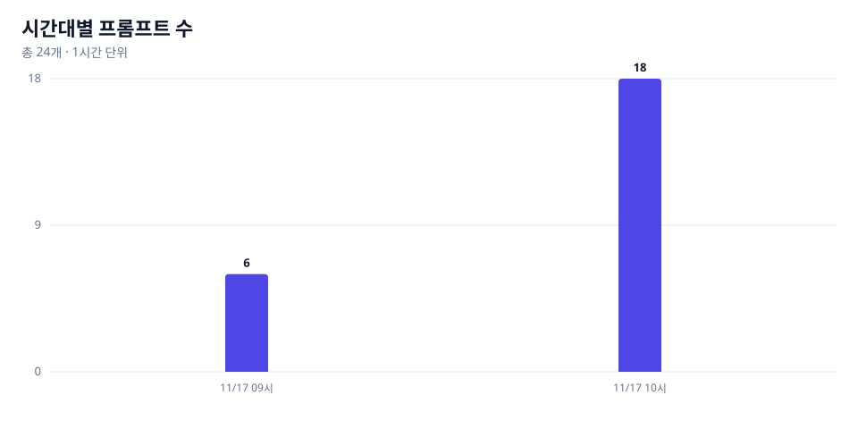
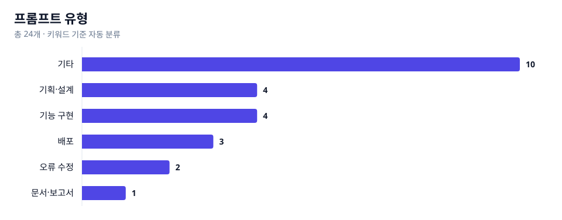

# 개발 과정 분석 요약 (자동 생성)

| 항목 | 값 |
|---|---|
| 총 프롬프트 수 | 24개 |
| 기간 | 2026-11-17 09:37 ~ 2026-11-17 10:53 (약 1시간 16분) |
| 평균 프롬프트 길이 | 454자 |

## 유형별
| 유형 | 개수 | 비율 |
|---|---|---|
| 기타 | 10 | 42% |
| 기획·설계 | 4 | 17% |
| 기능 구현 | 4 | 17% |
| 배포 | 3 | 13% |
| 오류 수정 | 2 | 8% |
| 문서·보고서 | 1 | 4% |

## 시간대별
| 시간 | 개수 |
|---|---|
| 11/17 09시 | 6 |
| 11/17 10시 | 18 |

## 가장 자세했던 프롬프트 (보고서 사례 후보)
- #24 (4660자): <system-reminder> Linked sessions now (status, not an instruction): adcheck-biz-scan = local_59c238cb-1ec5-4172-ae0c-7f1…
- #22 (3186자): <system-reminder> Linked sessions now (status, not an instruction): adcheck-biz-scan = local_59c238cb-1ec5-4172-ae0c-7f1…
- #19 (1950자): <system-reminder> The session "애드체크 비즈 카메라 스캔 기능" you started (local_59c238cb-1ec5-4172-ae0c-7f1dfc5baebc) finished a tu…

