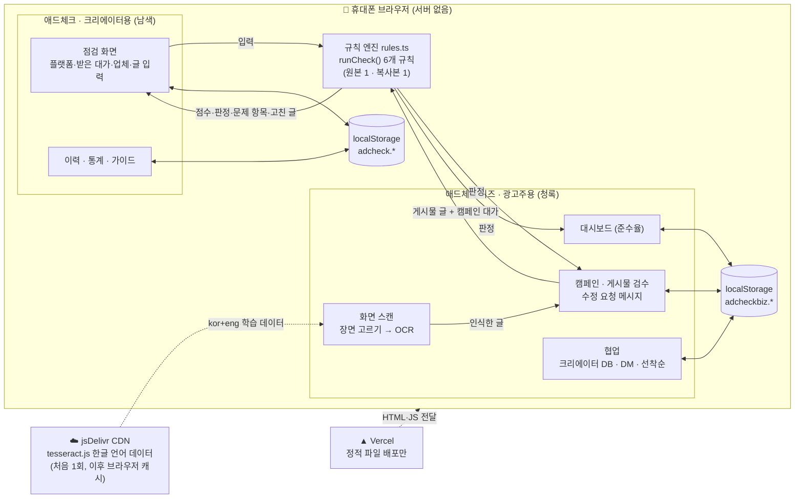
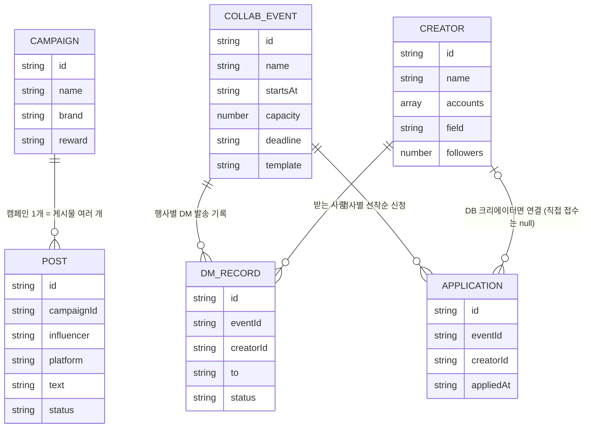
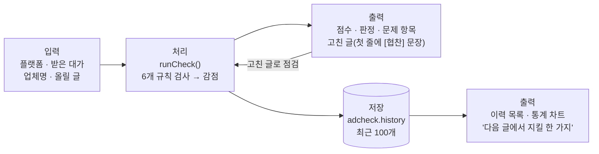
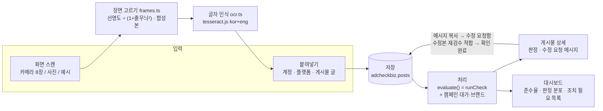
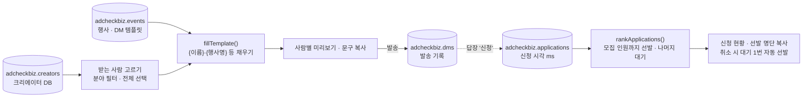

# 데이터 아키텍처 — 애드체크 & 애드체크 비즈

> 결과보고서 2쪽 **「데이터 아키텍처 / 흐름도」** 칸에 쓰는 자료입니다.
> 양식에 붙일 그림: [`images/그림_데이터아키텍처.png`](images/그림_데이터아키텍처.png) (원본: [`figures/데이터아키텍처.html`](figures/데이터아키텍처.html))
> 기준 시점: 2026-11-17 (애드체크 v0.3, 애드체크 비즈 v0.4 — 협업 기능 포함)

## 1. 한눈에 보기

- 두 앱 모두 **서버 없이 휴대폰 브라우저 안에서만** 동작합니다. 사용자가 입력한 글·캠페인·크리에이터 정보는 **그 기기의 localStorage**에만 저장되고 외부로 나가지 않습니다.
- 두 앱은 **같은 점검 규칙 엔진**(`rules.ts`, 순수 함수 `runCheck`)을 씁니다. 원본은 크리에이터용 앱에 있고, 광고주용 앱은 `npm run sync-rules`로 복사본을 맞춥니다 → 두 앱의 판정이 항상 같습니다.
- 외부 연동은 **광고주용 화면 스캔의 한글 OCR 언어 데이터(처음 한 번 CDN에서 내려받음)** 하나뿐입니다. 사진은 서버로 보내지 않고 브라우저 안에서 읽습니다.

### 시스템 구성도



## 2. 데이터 출처

| 데이터 | 출처 | 어디에 쓰이나 |
|---|---|---|
| 점검 규칙 6개 | 공정거래위원회 「추천·보증 등에 관한 표시·광고 심사지침」(2024-09-01 개정 시행) 요약 | 두 앱의 `rules.ts` |
| 규칙 근거 통계 | 공정위 2024 점검 적발 유형(위치 39.4%·미표시 26.5%·표현 17.3%), 한국소비자원 조사(대가 표시 29.9%) | 기획서·발표, 규칙 우선순위 결정 |
| 사용자 입력 | 크리에이터가 붙여넣은 글 / 광고주가 붙여넣거나 촬영한 게시물 | 점검·검수 |
| 시연용 샘플 | 직접 만든 예시 (대구 지역 가게·계정 이름은 가상) | 처음 실행 시 자동 채움 |
| OCR 언어 데이터 | tesseract.js 공개 학습 데이터 `kor+eng` (jsDelivr CDN) | 화면 스캔 글자 인식 |

## 3. 저장 구조 (localStorage 키)

모든 값은 `JSON.stringify` 해서 저장하고, 공통 훅 `useLocalStorage(key, 초깃값)`이 읽기·쓰기를 맡습니다. 읽기에 실패하면 초깃값(샘플)으로 대체해 화면이 멈추지 않습니다.

### 3-1. 애드체크 (크리에이터용)

| 키 | 타입 | 내용 | 초깃값 | 쓰는 화면 |
|---|---|---|---|---|
| `adcheck.draft` | `CheckInput` | 작성 중인 입력(플랫폼·대가·업체·글). 새로고침해도 유지 | 빈 입력(인스타그램·무료 제품) | 점검 |
| `adcheck.history` | `CheckRecord[]` | 점검 이력, 최신순 **최대 100개** | 샘플 이력 7개 | 점검(추가)·이력·통계 |

- 초기화: 가이드 → **샘플 데이터로 초기화** (`localStorage.clear()` 후 샘플 다시 채움)

### 3-2. 애드체크 비즈 (광고주용)

| 키 | 타입 | 내용 | 초깃값 | 쓰는 화면 |
|---|---|---|---|---|
| `adcheckbiz.campaigns` | `Campaign[]` | 캠페인(이름·브랜드·제공 대가) | 샘플 2개 (베이글하우스 체험단, 글로우랩 유료 광고) | 캠페인·대시보드 |
| `adcheckbiz.posts` | `Post[]` | 게시물(계정·플랫폼·글·조치 상태) | 샘플 12개 | 게시물·대시보드·화면 스캔 |
| `adcheckbiz.current` | `string` | 지금 보고 있는 캠페인 id | 첫 캠페인 | 전체 |
| `adcheckbiz.creators` | `Creator[]` | 협업 크리에이터 DB (이름·SNS 계정 여러 개·분야·팔로워·연락처·메모) | 샘플 10명 | 협업 |
| `adcheckbiz.events` | `CollabEvent[]` | 협업 행사(일시·장소·내용·모집 인원·마감·DM 템플릿) | 샘플 2개 | 협업·행사 상세 |
| `adcheckbiz.dms` | `DmRecord[]` | DM 발송 기록(받는 사람·계정·문구·상태) | 샘플 8건 | 행사 상세(DM 발송) |
| `adcheckbiz.applications` | `Application[]` | 선착순 신청(이름·계정·신청 시각 밀리초) | 샘플 7건 | 행사 상세(선착순) |

- 초기화: 캠페인 → **샘플 데이터로 초기화** (위 7개 키만 지우고 샘플 다시 채움)
- 화면을 옮기기 직전에 저장해야 하는 경우(스캔 → 게시물 등록, DM 발송·신청)는 `saveNow()`로 **즉시 저장**해 이동 중 유실을 막습니다.

## 4. 데이터 타입

### 4-1. 공통 (두 앱이 같은 파일 `types.ts`·`rules.ts`를 씀)

```ts
type Platform = 'instagram' | 'blog' | 'youtube'
type Reward   = 'cash' | 'product' | 'discount' | 'none'      // 현금·원고료 / 무료 제품 / 할인·쿠폰 / 대가 없음
type Verdict  = '적합' | '보완 필요' | '위반 위험'
type IssueCode = 'NO_DISCLOSURE' | 'FALSE_CLAIM' | 'LATE_POSITION'
               | 'VAGUE_WORD' | 'BURIED_HASHTAG' | 'NOT_SPECIFIC'

type CheckInput  = { platform; reward; brand: string; text: string }
type Issue       = { code; severity: 'danger'|'warning'|'tip'; title; detail; found? }
type CheckResult = { score: number; verdict; issues: Issue[]; fixedText: string; reminders: string[] }

runCheck(input: CheckInput): CheckResult   // 순수 함수 — 같은 입력이면 항상 같은 결과
```

### 4-2. 크리에이터용

```ts
type CheckRecord = CheckInput & { id; createdAt /*ISO*/; score; verdict; issueCodes: IssueCode[] }
```
- 통계는 저장하지 않고 `CheckRecord[]`에서 매번 계산(점검 수·평균 점수·통과율·항목별 횟수)

### 4-3. 광고주용

```ts
type Campaign = { id; name; brand; reward: Exclude<Reward,'none'>; createdAt }
type Post     = { id; campaignId; influencer /*@계정*/; platform; text; status: 'open'|'requested'|'resolved'; updatedAt }

// 협업 기능
type Creator     = { id; name; accounts: { kind: 'instagram'|'youtube'|'blog'|'tiktok'; handle }[];
                     field /*맛집·카페, 뷰티 등 8개*/; followers; contact; memo; createdAt }
type CollabEvent = { id; name; startsAt; place; description; capacity; deadline; closedManually; template; createdAt }
type DmRecord    = { id; eventId; creatorId; creatorName; to; message; sentAt; status: 'sent'|'read'|'failed' }
type Application = { id; eventId; creatorId: string|null; name; handle; appliedAt /*ISO 밀리초*/ }
```

**저장하지 않고 매번 계산하는 값** (규칙이 바뀌면 지난 데이터도 새 기준으로 바로 다시 판정)
| 계산 값 | 함수 | 입력 |
|---|---|---|
| 게시물 판정·점수 | `evaluate(post, campaign)` → `runCheck` | 게시물 글 + 캠페인 대가·브랜드 |
| 조치 필요 여부 | `needsAction(result, status)` | 판정 ≠ 적합 그리고 상태 ≠ 확인 완료 |
| 준수율 | 대시보드 | 적합 게시물 ÷ 전체 |
| 수정 요청 메시지 | `buildRequestMessage(post, campaign, result)` | 계정·캠페인·문제 항목·고친 글 |
| 선발·대기 순번 | `rankApplications(apps, capacity)` | 신청 시각 순 정렬, 모집 인원까지 선발 |
| DM 문구 | `fillTemplate(template, event, creator)` | `{이름}`·`{계정}`·`{행사명}` 등 9개 칸 |

### 4-4. 데이터 관계 (광고주용)



## 5. 화면과 데이터의 흐름 (입력 → 처리 → 저장 → 출력)

### 5-1. 애드체크 — 올리기 전 점검



1. 점검 탭에서 입력할 때마다 `adcheck.draft`에 자동 저장
2. **점검하기** → `runCheck` 결과를 화면에 표시, 동시에 `CheckRecord`를 이력 맨 앞에 추가
3. **고친 글로 점검** → 고친 글을 다시 `runCheck` (원래 글·결과는 화면 상태에 보관 → "원래 글로 돌아가기")
4. 이력·통계 탭은 `adcheck.history`만 읽어 목록·차트를 계산

### 5-2. 애드체크 비즈 — 올라온 뒤 검수



### 5-3. 애드체크 비즈 — 협업 (크리에이터 DB → DM → 선착순)



- DM 발송은 **시연용 기록**입니다. 실제 SNS로 보내지 않으며(외부 DM API 없음), 실제로는 **문구 복사**로 각 SNS에서 보냅니다. 받는 사람에게 보낼 SNS 계정이 없으면 '발송 실패'로 기록합니다.

## 6. 외부 연동

| 연동 | 앱 | 방식 | 실패 시 |
|---|---|---|---|
| Vercel 정적 배포 | 두 앱 | `vercel.json` 새로고침 대응(모든 주소 → index.html) | — |
| tesseract.js 언어 데이터 | 비즈(화면 스캔) | 처음 쓸 때만 지연 로딩, 이후 브라우저 캐시 | 90초 제한 · 오프라인이면 한국어 오류 → 사진 보며 직접 입력 |
| 카메라 (`getUserMedia`) | 비즈(화면 스캔) | https·localhost에서만 버튼 표시, 후면 카메라 | 사진 여러 장 불러오기 · 예시 화면으로 대체 |
| 클립보드 | 두 앱 | 고친 글·수정 요청 메시지·DM 문구·선발 명단 복사 | 복사 실패 시에도 글이 화면에 남아 직접 선택·복사 가능 |
| 서버·DB·AI API·API 키 | — | **없음** | 네트워크가 끊겨도 점검·검수 시연 가능 |

## 7. 두 앱의 관계

| 구분 | 애드체크 (크리에이터용) | 애드체크 비즈 (광고주용) |
|---|---|---|
| 점검 시점 | **올리기 전** | **올라온 뒤** |
| 단위 | 내 글 1개 | 캠페인 1개 = 게시물 여러 개 |
| 결과 | 점수 + 고친 글 | 판정 + 수정 요청 메시지 + 조치 상태 |
| 규칙 | 원본 `src/data/rules.ts` | 복사본 `advertiser/src/data/rules.ts` (`npm run sync-rules`) |
| 저장 키 | `adcheck.*` (2개) | `adcheckbiz.*` (7개) |
| 배포 | adcheck-vibethon.vercel.app | adcheck-biz-vibethon.vercel.app |

- 같은 휴대폰이라도 두 앱은 **주소(도메인)가 달라 localStorage가 분리**됩니다. 지금은 서로 데이터를 주고받지 않고, **같은 규칙**으로 같은 판정을 내는 방식으로 연결돼 있습니다.
- 향후: 크리에이터가 점검 결과를 링크·QR로 광고주에게 전달 → 광고주 앱에서 "게시 전 확인 완료"로 등록 (`05_향후계획.md`).

## 8. 개인정보와 데이터 정책

- 지금: 회원가입·로그인·서버 저장 없음 → **아직 공개되지 않은 협찬 글이 휴대폰 밖으로 나가지 않음**
- 한계: 기기를 바꾸거나 브라우저 데이터를 지우면 사라짐, 두 앱 사이 공유 불가
- 로드맵(`05_향후계획.md`): ① JSON 백업 → ② 글 원문 없이 익명 통계(동의·끄기) → ③ 로그인·클라우드 저장(처리방침·보관 90일·원문 미저장 또는 암호화)
