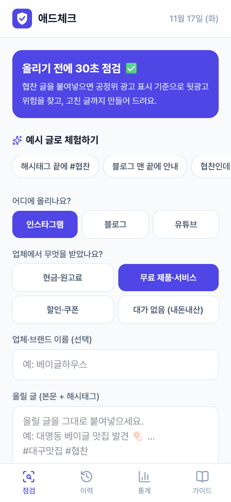
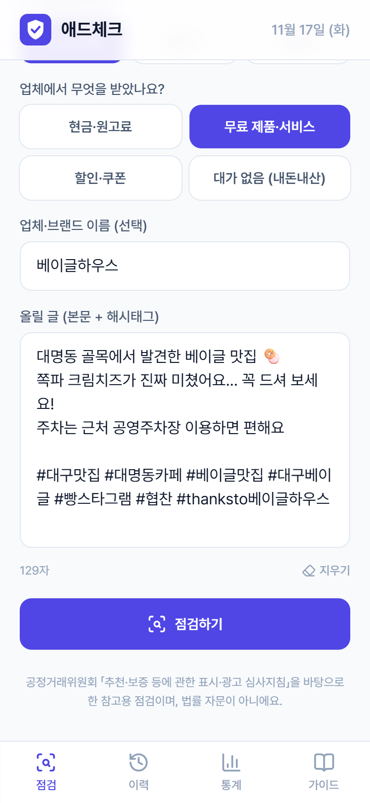
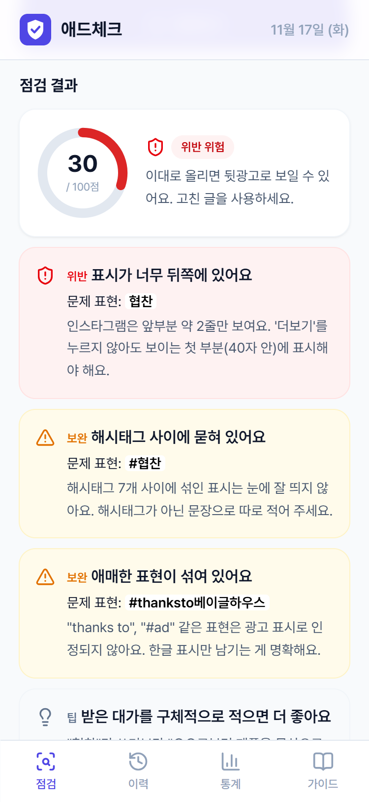
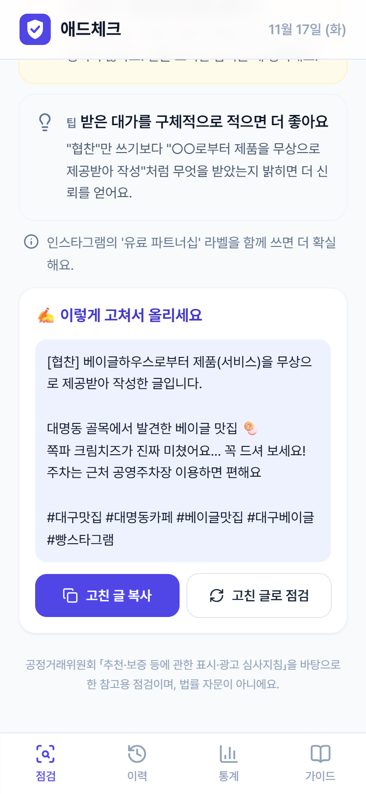
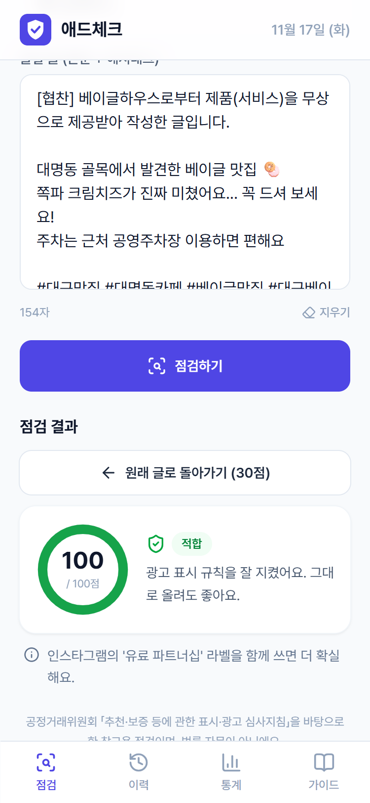
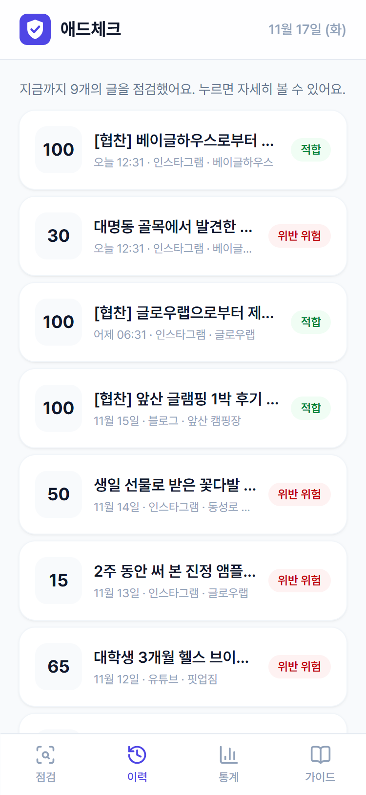
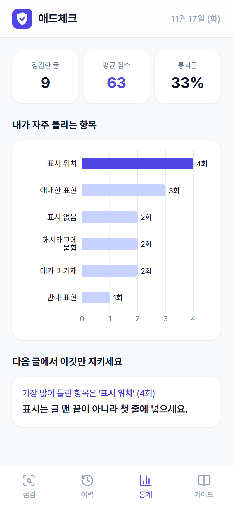
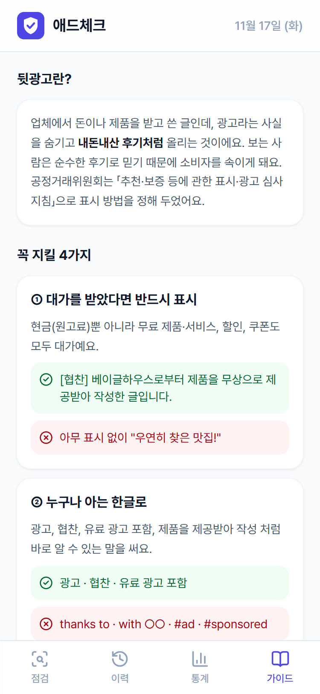

# 애드체크 사용설명서 (크리에이터용)

> 협찬 글을 올리기 전에 붙여넣으면 뒷광고 위험을 찾아 주고, 규칙에 맞게 고친 글까지 만들어 주는 광고 표시 점검기
> 앱 버전 v0.3 · 2026-11-17 기준 · 원본 설명서: [`../04_사용설명서.md`](../04_사용설명서.md)

| 항목 | 내용 |
|---|---|
| 접속 주소 | **https://adcheck-vibethon.vercel.app** (QR: [`../qr/adcheck_QR.png`](../qr/adcheck_QR.png)) |
| 권장 환경 | 휴대폰 브라우저 (크롬, 사파리, 삼성 인터넷) |
| 회원가입 | 필요 없음 |
| 저장 위치 | 이 휴대폰 브라우저 안 (서버로 전송하지 않음) |
| 광고주용 짝 앱 | 애드체크 비즈 — https://adcheck-biz-vibethon.vercel.app |

> 점검 결과는 공정거래위원회 「추천·보증 등에 관한 표시·광고 심사지침」을 바탕으로 한 **참고용**이며 법률 자문이 아닙니다.

---

## 1. 시작하기

1. 휴대폰 카메라로 QR을 찍거나 접속 주소를 엽니다.
2. 처음 열면 **샘플 점검 이력 7개**가 들어 있어 이력·통계 화면을 바로 볼 수 있습니다.
3. (선택) 브라우저 메뉴 → **홈 화면에 추가**를 누르면 앱처럼 아이콘으로 열 수 있습니다.
4. 아래쪽 탭 4개로 화면을 옮깁니다: **점검 · 이력 · 통계 · 가이드**

*첫 화면(점검 탭): 예시 글 버튼, 플랫폼·받은 대가 선택, 업체 이름, 올릴 글 입력칸*

---

## 2. 화면별 사용법

### 2-1. 점검 — 글 붙여넣고 점검하기

1. **어디에 올리나요?** — 인스타그램 / 블로그 / 유튜브 중 하나를 누릅니다.
2. **업체에서 무엇을 받았나요?** — 현금·원고료 / 무료 제품·서비스 / 할인·쿠폰 / 대가 없음(내돈내산)
3. **업체·브랜드 이름**(선택)을 쓰면 고친 글에 업체 이름이 들어갑니다.
4. **올릴 글**을 그대로 붙여넣습니다. 블로그·유튜브는 **첫 줄을 제목**으로 봅니다.
5. **점검하기**를 누릅니다.

> 처음이라면 **예시 글로 체험하기**의 버튼(해시태그 끝에 #협찬 / 블로그 맨 끝에 안내 / 협찬인데 내돈내산 / 잘 쓴 글)을 눌러 보세요. 입력칸이 자동으로 채워집니다.
> 쓰던 글은 자동으로 저장되어, 새로고침해도 사라지지 않습니다. 비우려면 입력칸 아래 **지우기**.

 

*왼쪽: '해시태그 끝에 #협찬' 예시를 넣은 모습 · 오른쪽: 점검 결과 — 30점 위반 위험, 문제 항목 3개와 팁 1개*

**결과 읽는 법**

| 표시 | 뜻 | 감점 |
|---|---|---|
| 🔴 **위반** | 표시 없음 · 반대 표현("내돈내산", "협찬 아님") · 표시 위치가 뒤쪽 | −35 |
| 🟡 **보완** | 애매한 표현(thanks to, with, #ad, #sponsored, 체험단) · 해시태그 5개 이상 사이에 묻힘 | −15 |
| 💡 **팁** | 무엇을 받았는지 구체적으로 적지 않음 | −5 |

- 100점에서 감점을 뺀 값이 점수입니다.
- 위반이 하나라도 있으면 **위반 위험**, 보완만 있으면 **보완 필요**, 그 외는 **적합**
- 각 항목의 **문제 표현**에 글에서 문제가 된 부분이 강조되어 나옵니다.
- '첫 부분' 기준: 인스타그램은 앞 **40자**('더보기' 없이 보이는 부분), 블로그·유튜브는 **제목(첫 줄)**

### 2-2. 고친 글 — 복사해서 바로 올리기

1. 결과 아래 **이렇게 고쳐서 올리세요** 카드에 수정본이 나옵니다.
   - 애매한 표현·반대 표현·해시태그 표시를 지우고
   - 맨 앞에 `[협찬] 베이글하우스로부터 제품(서비스)을 무상으로 제공받아 작성한 글입니다.` 같은 문장을 붙입니다.
   - 현금·원고료를 받았다면 `[광고] … 원고료를 받아 작성한 글입니다.`로 바뀝니다.
2. **고친 글 복사** → 인스타그램·블로그에 그대로 붙여넣습니다.
3. **고친 글로 점검** → 수정본을 다시 점검해 **적합**인지 확인합니다.
4. 비교하고 싶으면 **← 원래 글로 돌아가기 (30점)** 을 누르면 고치기 전 글과 결과로 돌아갑니다.

 

*왼쪽: 고친 글 카드와 복사·재점검 버튼 · 오른쪽: 고친 글로 다시 점검 → 100점 적합*

### 2-3. 이력 — 지난 점검 다시 보기

- 점검할 때마다 자동으로 저장됩니다 (**최근 100개**).
- 목록에서 점수·판정·날짜·플랫폼을 한눈에 봅니다. 누르면 원래 글과 점검 결과가 다시 열리고, 필요 없으면 삭제할 수 있습니다.

### 2-4. 통계 — 내가 자주 틀리는 항목

- 위쪽: **점검한 글 수 · 평균 점수 · 통과율(적합 비율)**
- **내가 자주 틀리는 항목** 차트: 가장 많이 틀린 항목이 진한 색으로 강조됩니다.
- **다음 글에서 이것만 지키세요**: 가장 많이 틀린 항목을 고치는 한 문장을 알려 줍니다.

### 2-5. 가이드 — 규칙 배우기와 초기화

- 뒷광고가 무엇인지, **꼭 지킬 4가지**(① 대가를 받았다면 반드시 표시 · ② 누구나 아는 한글로 · ③ 첫 부분에, 눈에 띄게 · ④ 거짓 표현 금지)를 좋은 예·나쁜 예로 보여 줍니다.
- 맨 아래 **샘플 데이터로 초기화**: 발표·시연 전 처음 상태로 되돌립니다. (내가 점검한 이력은 지워집니다)

---

## 3. 2분 시연 순서

1. 점검 → **해시태그 끝에 #협찬** → 점검하기 → **30점 위반 위험** (표시 위치·해시태그에 묻힘·애매한 표현)
2. **고친 글 복사** → **고친 글로 점검** → **100점 적합**
3. 통계 → "가장 많이 틀린 항목은 '표시 위치'" → 가이드에서 규칙 확인

---

## 4. 자주 묻는 질문

**Q. 내가 쓴 글이 어딘가로 전송되나요?**
아니요. 점검은 휴대폰 브라우저 안에서 계산되고, 이력도 이 휴대폰에만 저장됩니다. 서버·로그인이 없습니다.

**Q. 인터넷이 없어도 되나요?**
처음 한 번 열린 뒤에는 점검이 휴대폰 안에서 바로 계산됩니다.

**Q. '#협찬'을 붙였는데 왜 위반인가요?**
2024년 9월부터 시행된 개정 심사지침은 '더보기'를 눌러야 보이는 위치, 해시태그 사이에 묻힌 표시를 인정하지 않습니다. **글 첫 부분에, 문장으로** 쓰세요.

**Q. '#ad', 'Sponsored'는 안 되나요?**
국내 소비자를 대상으로 한 글이면 외국어 표현은 부적절한 표현으로 봅니다. '광고', '협찬'처럼 한글로 쓰세요. (해외 FTC 기준 도구와 다른 점)

**Q. 내 돈으로 산 제품 후기도 점검해야 하나요?**
'대가 없음(내돈내산)'을 고르면 표시 의무가 없으므로 적합으로 나옵니다. 단, 대가를 받았는데 "내돈내산"이라고 쓰면 **반대 표현(위반)** 입니다.

**Q. 유튜브 영상 속 표시도 점검하나요?**
아니요. 글(제목·설명)만 점검합니다. 유튜브는 결과 아래에 영상 시작·끝의 '유료 광고 포함' 안내와 '유료 프로모션 포함' 설정을 켜라는 안내가 따로 나옵니다.

**Q. 기기를 바꾸면 이력이 남나요?**
아니요. 이력은 이 휴대폰 브라우저에만 있어, 기기를 바꾸거나 브라우저 데이터를 지우면 사라집니다. (향후 JSON 백업 기능 예정)

**Q. 처음 상태로 돌리려면?**
가이드 → **샘플 데이터로 초기화**.

**Q. 점검 결과를 믿고 올려도 되나요?**
공정위 심사지침을 바탕으로 한 참고용 점검입니다. 법률 자문이 아니므로 애매하면 업체·전문가와 확인하세요.
