# 애드체크 비즈 사용설명서 (광고주용)

> 체험단·협찬 캠페인 게시물의 광고 표시를 한 번에 검수하고, 수정 요청 메시지와 크리에이터 섭외(DM·선착순 선발)까지 한곳에서 하는 도구
> 앱 버전 v0.4 · 2026-11-17 기준 · 원본 설명서: [`../../advertiser/docs/04_사용설명서.md`](../../advertiser/docs/04_사용설명서.md)

| 항목 | 내용 |
|---|---|
| 접속 주소 | **https://adcheck-biz-vibethon.vercel.app** (QR: [`../qr/adcheck-biz_QR.png`](../qr/adcheck-biz_QR.png)) |
| 권장 환경 | 휴대폰 브라우저 (크롬, 사파리, 삼성 인터넷) — https라서 카메라 사용 가능 |
| 회원가입 | 필요 없음 |
| 저장 위치 | 이 기기 브라우저 안 (사진·글 모두 서버로 전송하지 않음) |
| 크리에이터용 짝 앱 | 애드체크 — https://adcheck-vibethon.vercel.app (같은 점검 규칙) |

> 협업 탭(크리에이터 DB · 행사 DM · 선착순 선발, v0.4)은 2026-11-17 오후에 추가되어 배포본에 반영되었습니다.

---

## 1. 시작하기

1. 휴대폰으로 QR을 찍거나 접속 주소를 엽니다.
2. 처음 열면 시연용 샘플이 들어 있습니다.
   - 캠페인 2개: **베이글하우스 · 신메뉴 체험단 11월**(무료 제품, 게시물 8개), **글로우랩 · 진정앰플 유료 광고**(현금, 게시물 4개)
   - 협업 크리에이터 10명, 협업 행사 2개(모집 중 1 · 마감 1)
3. 아래쪽 탭 5개: **대시보드 · 게시물 · 화면 스캔 · 협업 · 캠페인**
4. 위쪽 **캠페인 선택**에서 보고 싶은 캠페인을 고릅니다.

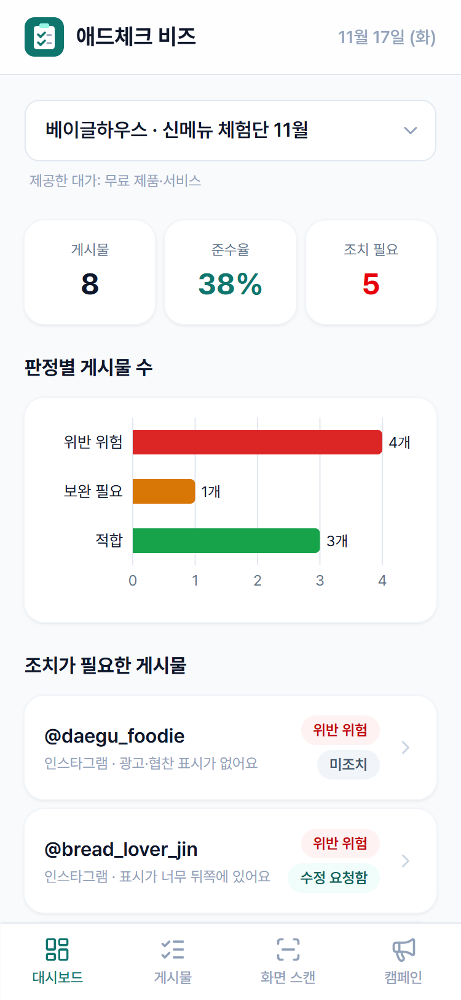

*첫 화면(대시보드): 게시물 8개 · 준수율 38% · 조치 필요 5개, 판정별 게시물 수 차트*

---

## 2. 화면별 사용법

### 2-1. 캠페인 — 캠페인 만들기

1. **캠페인** 탭 → 캠페인 이름(예: 겨울 신메뉴 체험단), 브랜드·가게 이름 입력
2. 인플루언서에게 제공한 대가 선택: 현금·원고료 / 무료 제품·서비스 / 할인·쿠폰
3. **캠페인 만들기** → 게시물 탭으로 이동합니다. 이후 게시물마다 대가를 다시 넣지 않아도 됩니다.
- 캠페인 목록에서 캠페인을 누르면 그 캠페인으로 바뀝니다 (게시물 수·준수율 표시).
- 맨 아래 **샘플 데이터로 초기화 (시연 전에 사용)**: 캠페인·게시물·협업 데이터를 모두 처음 상태로 되돌립니다.

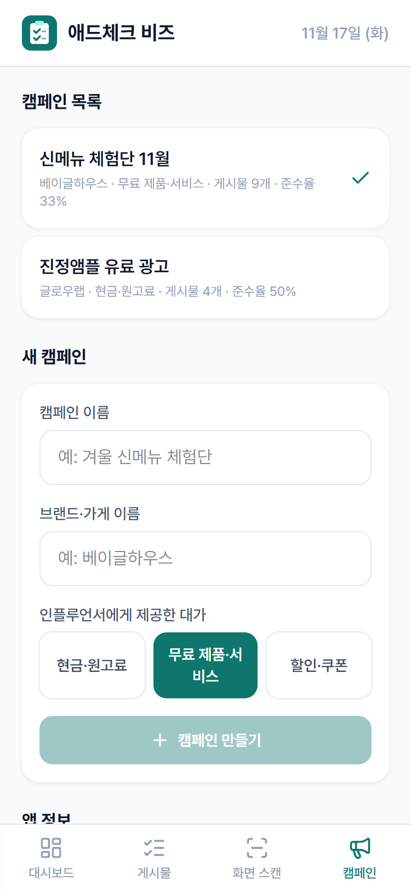

### 2-2. 게시물 — 등록하고 검수하기

1. **게시물** 탭 → 오른쪽 아래 **+**
2. 인플루언서 계정(@ 없이 써도 됨), 플랫폼(인스타그램·블로그·유튜브), 게시물 글을 붙여넣습니다.
3. **등록하고 검수하기** → 바로 점수와 판정(적합 / 보완 필요 / 위반 위험)이 나옵니다.
- 위쪽 필터로 **전체 / 조치 필요 / 문제 없음**만 골라 볼 수 있습니다.
- 목록 왼쪽 숫자가 점수, 오른쪽이 판정과 조치 상태입니다.

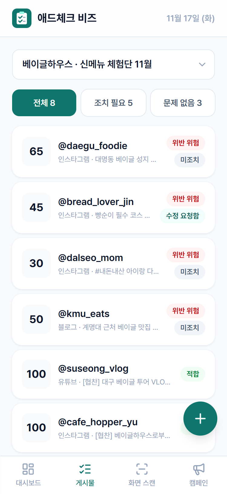 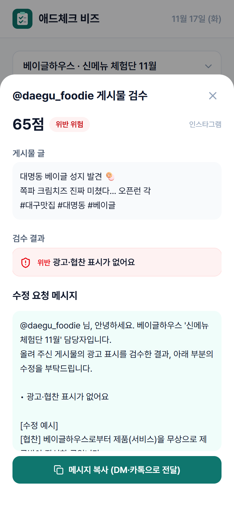

*왼쪽: 게시물 목록(점수·판정·조치 상태) · 오른쪽: 게시물을 누르면 열리는 검수 결과 — @daegu_foodie 65점 위반 위험*

### 2-3. 수정 요청 보내기와 조치 상태

1. 게시물을 누르면 검수 결과 아래 **수정 요청 메시지**가 나옵니다. 인사 · 문제 항목 · **수정 예시 글** · 심사지침 안내가 들어 있습니다.
2. **메시지 복사 (DM·카톡으로 전달)** → 인스타그램 DM이나 카카오톡에 붙여넣어 보냅니다. 복사하면 상태가 자동으로 **수정 요청함**이 됩니다.
3. 인플루언서가 글을 고치면 **인플루언서가 고친 글 붙여넣기** 칸에 넣고 **수정본 다시 검수** → 적합이면 자동으로 **확인 완료**가 됩니다.
- 조치 상태(미조치 / 수정 요청함 / 확인 완료)는 직접 눌러 바꿀 수도 있습니다.

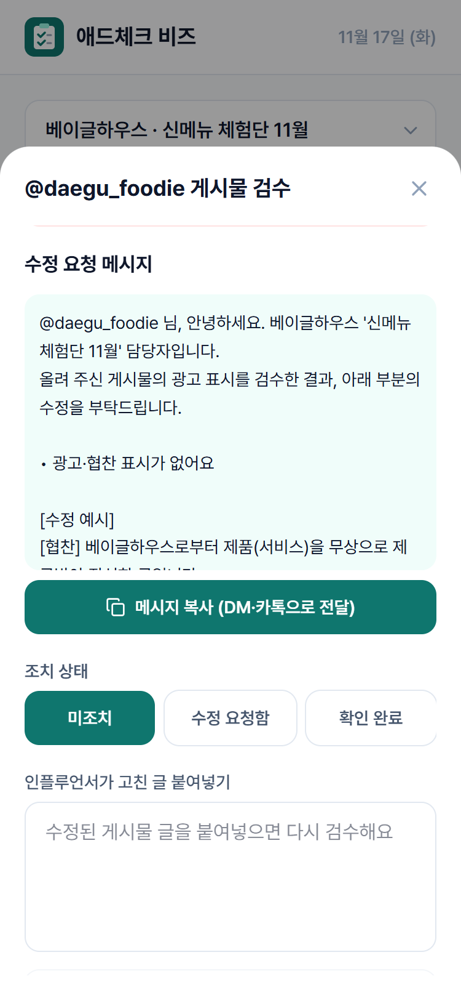

### 2-4. 대시보드 — 캠페인 현황 한눈에

- **게시물 · 준수율 · 조치 필요** 숫자 3개
  - 준수율 = 적합 게시물 ÷ 전체 게시물
  - 조치 필요 = 적합이 아니면서 아직 확인 완료가 아닌 게시물
- **판정별 게시물 수** 차트(위반 위험 / 보완 필요 / 적합)
- **조치가 필요한 게시물** 목록: 누르면 바로 상세 검수 화면이 열립니다.

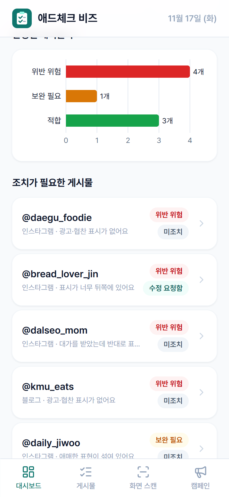

### 2-5. 화면 스캔 — 글을 복사할 수 없을 때

인플루언서가 휴대폰으로 보여 주거나 회의실 모니터에 띄운 게시물은 찍어서 등록합니다. 화면을 찍으면 깜빡임 때문에 가로 줄무늬가 생기고 손떨림으로 흐려지므로, **여러 장 찍어 가장 좋은 장면**을 고릅니다.

1. **화면 스캔** 탭 → 위에서 캠페인 선택
2. 셋 중 하나를 고릅니다.
   - **카메라 켜기** → 화면 전체가 들어오게 맞추고 **연속 8장 촬영** (휴대폰을 최대한 움직이지 마세요)
   - **사진 여러 장 불러오기** → 카메라 앱으로 같은 화면을 여러 장 찍어 두었다가 한꺼번에 선택
   - **예시 화면으로 체험** → 카메라 없이 흔들림·줄무늬가 들어간 예시 사진 6장으로 체험
3. **장면 고르기**: 점수 높은 순으로 나옵니다. 1위에 **추천**, 여러 장을 겹쳐 줄무늬를 지운 장면에 **합성** 표시. 다른 장면을 누르면 바꿀 수 있습니다.
4. **이 장면으로 글자 읽기** → 인식된 글을 사진과 비교해 틀린 글자를 고칩니다.
5. 계정(화면 맨 위 계정 이름을 자동으로 채움)과 플랫폼을 확인하고 **게시물로 등록하고 검수** → 검수 결과와 수정 요청 메시지가 바로 열립니다.

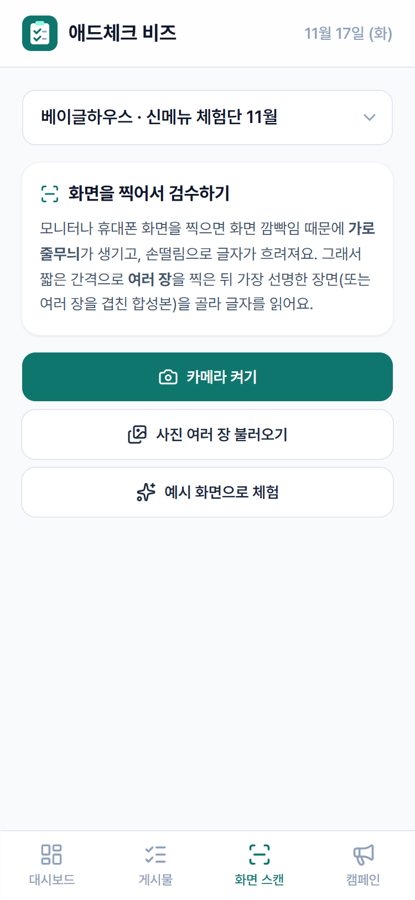 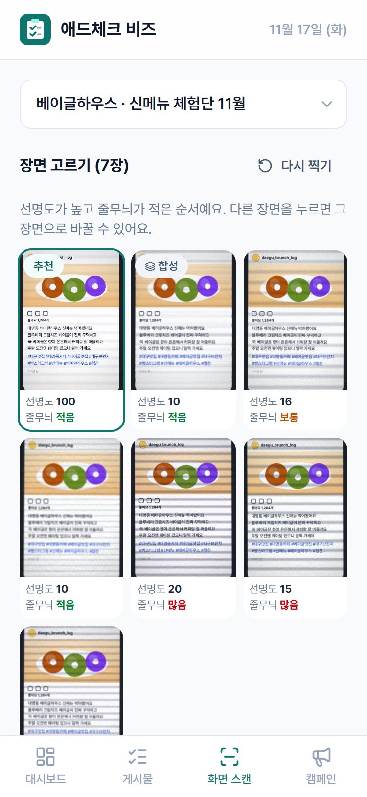 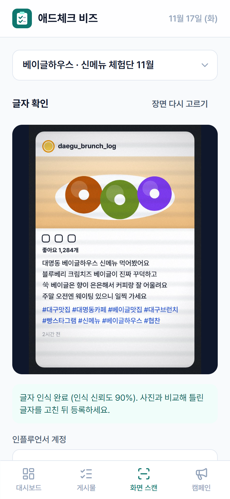 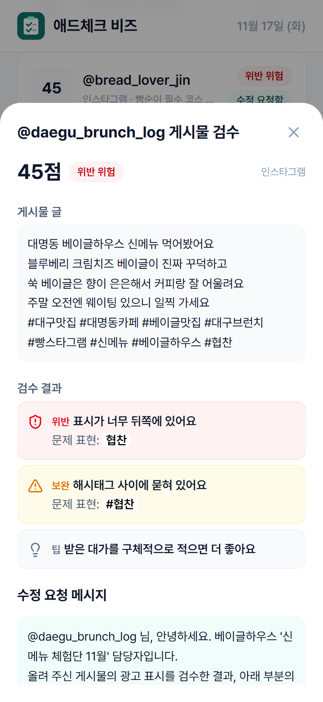

*시작 → 장면 고르기(추천·합성) → 글자 인식(신뢰도 90%) → 등록 즉시 검수: @daegu_brunch_log 45점 위반 위험*

### 2-6. 협업 — 크리에이터 DB

1. **협업** 탭 → 위에서 **크리에이터 DB**
2. 오른쪽 아래 **+** → 이름, 분야(맛집·카페, 뷰티 등 8개), 팔로워 수, SNS 계정(인스타·유튜브·블로그·틱톡, 여러 개 가능), 연락처, 메모 → **크리에이터 등록**
3. 목록은 팔로워 많은 순입니다. 검색창(이름·계정·메모)과 분야 칩으로 걸러 봅니다.
4. 크리에이터를 누르면 정보를 고치거나 삭제할 수 있습니다.

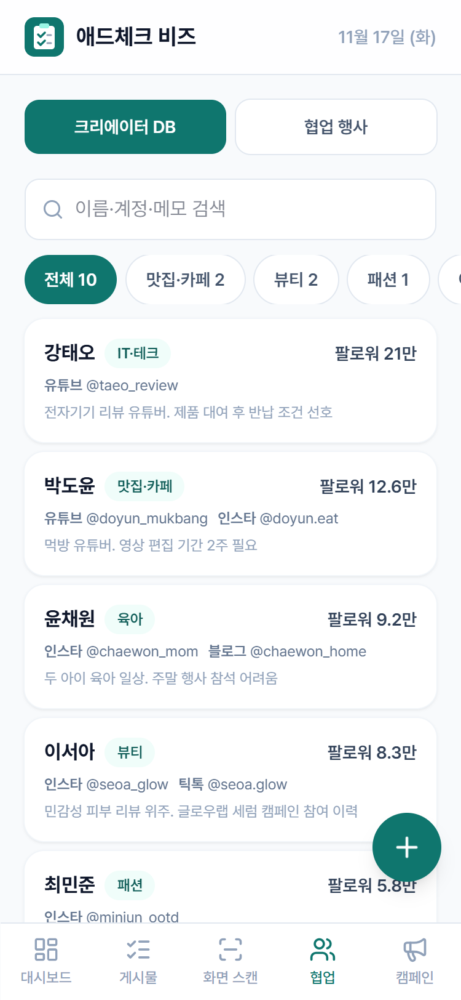 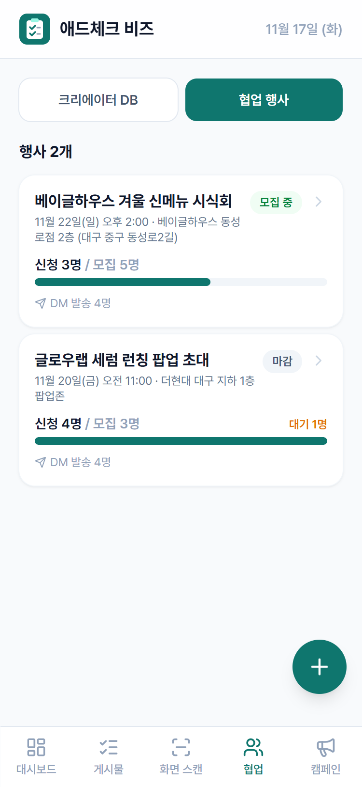

*왼쪽: 크리에이터 DB(샘플 10명) · 오른쪽: 협업 행사 목록 — 신청 수/모집 인원, 대기 인원, DM 발송 수*

### 2-7. 협업 — 행사 고지 DM 보내기

1. **협업 행사** → **+** → 행사 이름, 일시, 장소, 내용, 모집 인원, 신청 마감 → **행사 만들기**
2. 행사를 눌러 **DM 발송** 화면에서
   - **1. 받는 사람**: 분야 칩으로 거르고 **전체 선택** 또는 한 명씩 체크 (이미 보낸 사람은 '보냄' 표시)
   - **2. DM 문구**: 기본 문구를 자유롭게 고치고, `{이름}` `{계정}` `{행사명}` `{일시}` `{장소}` 등 칩을 누르면 사람마다 자동으로 바뀌는 칸이 들어갑니다.
   - **3. 미리보기**: ◀ ▶ 로 사람별 문구를 확인하고 **문구 복사**
3. **선택한 n명에게 발송** → 발송 기록에 받는 사람·계정·시각·상태(발송 완료 / 읽음 / 발송 실패)가 남습니다.
- **시연용**: 실제 SNS로 보내지 않고 기록만 남깁니다. 실제로는 문구를 복사해 각 SNS DM으로 보내세요. SNS 계정이 없는 사람은 '발송 실패'로 기록됩니다.

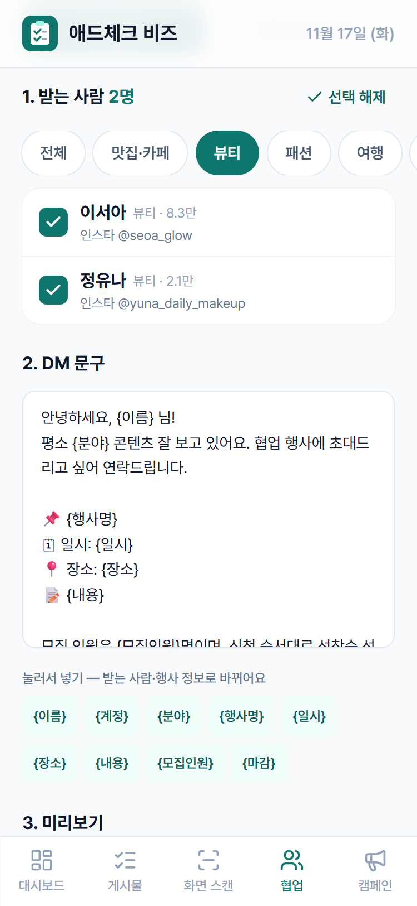 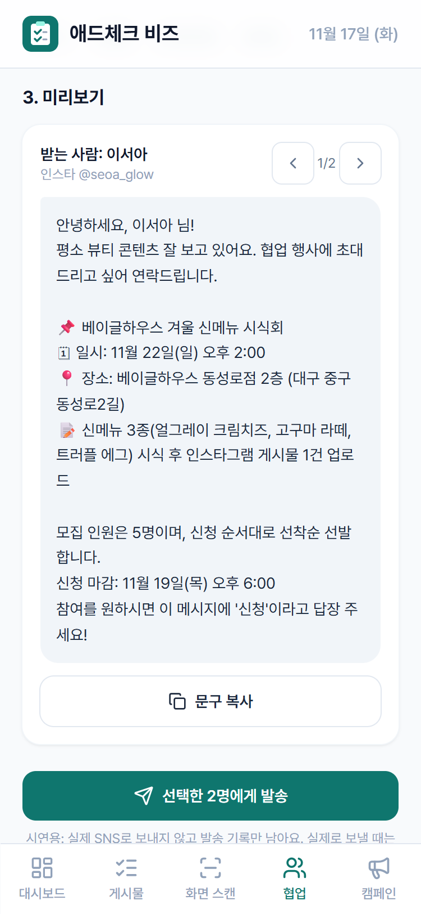 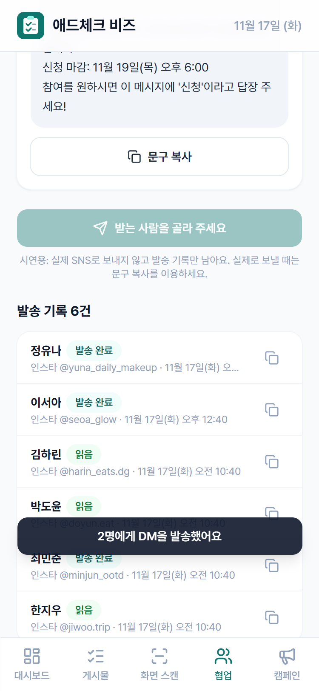

*뷰티 분야 2명 선택 → 사람별 미리보기 → 발송 후 기록 6건*

### 2-8. 협업 — 선착순 선발

1. 행사 화면 → **선착순 신청**
2. 카운터에 **신청 n명 / 모집 m명**, 진행 막대, 선발·대기·남은 자리, 마감까지 남은 시간이 나옵니다.
3. 신청자는 **신청 시각(밀리초까지) 순**으로 정렬되어 모집 인원까지 **선발**, 나머지는 **대기 1, 2, …** 가 자동으로 붙습니다. 경계에 '여기부터 대기' 줄이 표시됩니다.
4. 신청 받기
   - **신청 1명 / 5명 몰리기**(시연용): DB의 크리에이터가 신청한 것처럼 추가
   - **신청 직접 접수 (DM 답장 받은 사람)**: 이름·계정을 넣으면 지금 시각으로 접수
5. 신청자 옆 **×** 로 취소하면 **대기 1번이 자동으로 선발**됩니다.
6. 마감 시각이 지나거나 **지금 마감하기**를 누르면 추가 신청이 막힙니다.
7. **선발 명단 복사**로 공지용 명단을 복사합니다.

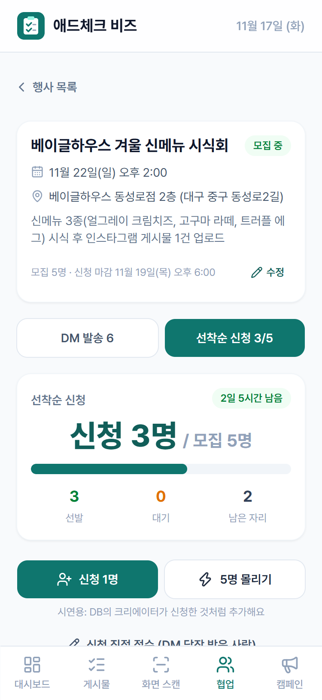 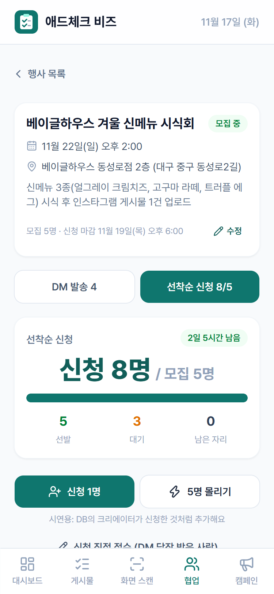 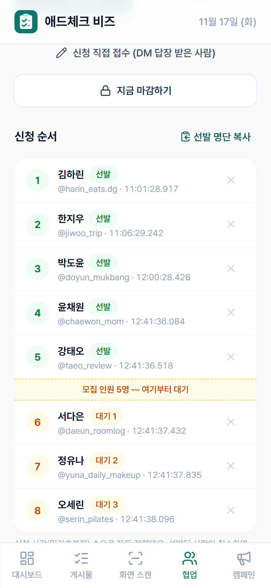

*신청 3/5 → '5명 몰리기' 후 8/5 (선발 5 · 대기 3) → 신청 순서 명단과 '여기부터 대기' 경계*

---

## 3. 1분 30초 시연 순서

1. 대시보드: 베이글하우스 체험단 게시물 8개, **준수율 38%**, 판정 분포 차트
2. 조치 필요 게시물 → **메시지 복사**(수정 요청함) → 고친 글 붙여넣기 → **수정본 다시 검수** → 확인 완료 → 준수율 상승
3. 화면 스캔 → **예시 화면으로 체험** → 추천 장면 → 글자 읽기 → 등록 → **45점 위반 위험**
4. (협업) 행사 → 뷰티 크리에이터 선택 → DM 발송 → 선착순 **5명 몰리기** → 선발·대기 자동 표시

> 시연 전: 캠페인 → 샘플 데이터로 초기화, 화면 스캔을 한 번 실행해 한글 데이터를 미리 받아 두기

---

## 4. 자주 묻는 질문

**Q. 게시물 링크만 넣으면 안 되나요?**
인스타그램·블로그는 외부에서 글을 가져오는 것을 막고 있어, 글을 복사해 붙여넣거나 화면 스캔을 이용해야 합니다.

**Q. 크리에이터용 애드체크와 판정이 같나요?**
네. 두 앱은 같은 점검 규칙 파일을 씁니다. 크리에이터가 애드체크에서 적합을 받은 글은 여기서도 적합입니다.

**Q. 찍은 사진이 서버로 가나요?**
아니요. 장면 고르기와 글자 인식 모두 휴대폰 브라우저 안에서 처리됩니다. 처음 한 번 한글 인식 데이터만 인터넷에서 받습니다(10~20초).

**Q. 카메라 버튼이 안 보여요.**
보안 연결(https)이 아닌 주소입니다. 배포 주소로 열거나 **사진 여러 장 불러오기**를 이용하세요.

**Q. 글자 인식이 틀려요 / 인터넷이 없어요.**
인식된 글을 사진과 비교해 직접 고칠 수 있습니다. 인식에 실패하면 사진을 보며 글을 직접 입력하세요.

**Q. 수정 요청 메시지나 행사 DM을 앱에서 바로 보내나요?**
아니요. 복사해서 평소 쓰는 DM·카카오톡으로 보냅니다. 행사 DM의 '발송'은 누구에게 언제 보냈는지 남기는 기록용(시연용) 기능입니다.

**Q. 선착순은 어떻게 공정하게 정하나요?**
신청 시각을 밀리초(1/1000초)까지 기록해 빠른 순서대로 선발합니다. 선발자가 취소하면 대기 1번이 자동으로 올라갑니다.

**Q. 크리에이터 연락처 같은 정보는 어디에 저장되나요?**
이 기기 브라우저에만 저장되고 서버로 보내지 않습니다. 기기를 바꾸거나 브라우저 데이터를 지우면 사라집니다.

**Q. 처음 상태로 돌리려면?**
캠페인 → **샘플 데이터로 초기화**.
